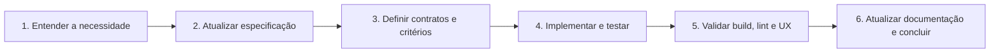

# Spec-Driven Development (SDD) — Mybox

> Guia de desenvolvimento orientado a especificações para o supervisório Mybox.
> Esta documentação descreve o produto e o código existentes; requisitos ainda não
> implementados estão identificados como evolução proposta, não como comportamento atual.

## 1. O que é SDD?

No Spec-Driven Development, a especificação é a referência verificável para o
comportamento esperado, os contratos, as decisões técnicas e os critérios de aceite.
Uma implementação deve atender a esses requisitos, e testes devem tornar esse
atendimento repetível.

No Mybox, as especificações servem à equipe e a agentes de IA. Elas não substituem o
código nem os contratos do firmware: quando houver divergência, investigue, documente
a decisão e atualize a especificação e a implementação de forma coordenada.

## 2. Ciclo de desenvolvimento

1. Identifique o problema, usuários afetados e escopo; consulte as especificações relacionadas.
2. Descreva comportamento atual e desejado, incluindo casos de erro e estados vazios.
3. Atualize tipos e contratos de API quando necessário; não invente detalhes do firmware.
4. Implemente seguindo a arquitetura e escreva testes que cubram os critérios de aceite.
5. Execute a validação mais específica que cubra a alteração e confira fluxos relevantes.
6. Atualize as especificações, anote limitações restantes e comunique os resultados.

## 3. Mapa das especificações

1. [Produto e regras de negócio](./01-product-specification.md) — propósito, atores e
   comportamento principal do supervisório.
2. [Arquitetura e stack](./02-architecture-and-tech-stack.md) — tecnologias, camadas e
   padrões de implementação.
3. [Modelos de dados e contratos](./03-data-models-and-contracts.md) — tipos TypeScript
   do domínio.
4. [API e integração com dispositivo](./04-api-and-device-contracts.md) — rotas,
   payloads conhecidos e lacunas que precisam de confirmação com o firmware.
5. [UI/UX e componentes](./05-ui-ux-specification.md) — telas e interações existentes.
6. [Testes e qualidade](./06-testing-and-quality.md) — comandos e critérios de validação.
7. [Roadmap e Definition of Done](./07-implementation-roadmap.md) — sequência de
   evolução e condições de conclusão.

## 4. Regras para mudanças e agentes de IA

- Antes de codificar, identifique os documentos desta pasta que governam a mudança.
- Separe fatos observados no código de propostas e de questões ainda não confirmadas.
- Preserve os contratos do dispositivo e confirme mudanças de payload com a API/firmware.
- Prefira Signals para estado local e componentes standalone; use RxJS para operações
  assíncronas HTTP e composição de streams quando isso trouxer clareza.
- Siga componentes compartilhados Zard, classes Tailwind existentes, acessibilidade e
  localização em português.
- Não inclua senhas reais, tokens, endereços privados de produção ou outros segredos em
  documentação, logs, testes versionados ou exemplos.
- Cada critério de aceite deve ser verificável. Evite testes que apenas repetem detalhes
  internos de implementação.
- Ao concluir uma mudança, atualize documentos afetados e reporte validações executadas,
  limitações e eventuais divergências entre a API real e os contratos descritos aqui.

## 5. Definition of Done (DoD)

Uma mudança está pronta quando:

- os critérios de aceite da especificação foram atendidos;
- os tipos e contratos permanecem coerentes entre tela, serviço e API;
- erros, carregamento, desabilitação de ações e feedback ao usuário foram tratados;
- testes relevantes passam; testes ausentes ou obsoletos foram identificados, não presumidos;
- build e lint aplicáveis passam, ou falhas preexistentes são claramente registradas;
- documentação relacionada reflete o comportamento entregue;
- não foram introduzidos segredos nem alterações fora do escopo.
